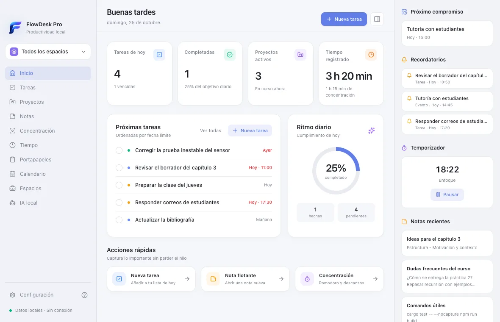
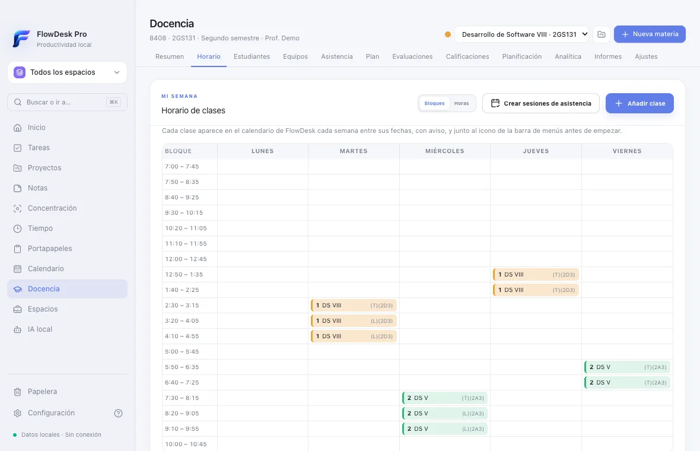

# FlowDesk Pro

Productividad local y privada para macOS: tareas, proyectos, calendario, notas flotantes, concentración, seguimiento del tiempo y una sección completa de **Docencia** para llevar materias, estudiantes, asistencia y calificaciones. Todo en una sola app, con los datos en tu Mac y sin cuentas ni servicios en la nube.

Hecha con Tauri 2, Rust, React, TypeScript, Tailwind CSS y SQLite. Disponible para Mac con Apple Silicon.

<picture>
  <source media="(prefers-color-scheme: dark)" srcset="src/features/onboarding/assets/dashboard/dashboard-dark.webp">
  
</picture>

**[Descargar la última versión](https://github.com/JoseLMendozaV/flowdesk-pro/releases/latest)** · [Instalación](#instalación) · [Funciones](#funciones) · [Licencia](#licencia)

## Funciones

### Organización

- **Inicio:** las tareas de hoy, el próximo compromiso, los recordatorios, el temporizador en marcha y las notas recientes de un vistazo.
- **Tareas:**
  - subtareas, etiquetas, prioridades y fecha límite con o sin hora;
  - **fecha de inicio**: no aparecen en Hoy hasta el día en que se pueden empezar;
  - vistas Hoy, Próximas, Todas y Completadas, en lista o en **Kanban**, con búsqueda, filtros y panel de detalle que guarda solo.
- **Tareas y eventos que se repiten:**
  - cada día, los días laborables, cada semana, mes o año, o personalizado;
  - en las tareas, también «un tiempo después de completarla»;
  - en los eventos, al cambiar o borrar se elige «solo este», «este y los siguientes» o «todos».
- **Proyectos** con progreso, estadísticas, archivado y vínculos con tareas, notas y eventos.
- **Calendario:**
  - vistas de día, semana y mes;
  - las tareas aparecen a su hora con su duración estimada;
  - eventos y tareas se **arrastran** para cambiarlos de hora o de día y se **estiran** para cambiar su duración.
- **Recordatorios** de tareas, eventos y notas, con resumen diario y horas de silencio. Funcionan con la ventana cerrada y no se repiten tras el reposo del Mac.
- **Espacios de trabajo** (Docencia, Investigación, Programación…): filtran tareas, proyectos, notas y agenda, y abren sus carpetas y apps.

### Notas flotantes

- Ventanas independientes que quedan **encima de todo** o en el escritorio.
- Editor enriquecido: formato, listas de verificación, tablas, imágenes y archivos adjuntos.
- Por nota: color, transparencia, tamaño de texto y colapso.
- Contextos (eventos y documentos), **historial de versiones**, recuperación tras un cierre inesperado y aviso si se editó desde otra ventana.
- **⌥N** crea una nota desde cualquier app. El texto seleccionado se puede convertir en tarea.

### Concentración y tiempo

- **Pomodoro** con descansos cortos y largos, y **cronómetro** por proyecto. Siguen bien aunque el Mac duerma o cambie la hora.
- Estadísticas de tiempo por día, semana y proyecto.
- **Seguimiento automático por aplicación**, opcional y solo con tu permiso. No guarda títulos de ventanas.

### Docencia

La antigua app *Control Docente* integrada en FlowDesk. Cada materia es un proyecto, su horario llena el calendario y sus entregas y seguimientos aparecen donde trabajas.

<picture>
  <source media="(prefers-color-scheme: dark)" srcset="src/features/onboarding/assets/teaching/teaching-dark.webp">
  
</picture>

- **Horario semanal por bloques**, como la hoja oficial (con los bloques de 45 minutos de la UTP por defecto), con teoría y laboratorio. Las clases aparecen cada semana en el calendario, con aviso y junto al icono de la barra de menús.
- **Calendario académico:**
  - se cargan solos los **feriados de Panamá** (con el puente si caen en domingo) y el **calendario de la UTP**: días libres, semanas de exámenes y fechas límite;
  - esas clases salen del calendario y de la asistencia;
  - se pueden añadir días propios.
- **Estudiantes** (también importados desde Excel), con expediente: notas, asistencia, observaciones y recuperaciones.
- **Equipos**, con integrantes y líder.
- **Asistencia** por sesión, con las sesiones creadas desde el horario y **«Marcar a todos»**.
- **Plan del curso:**
  - pega el temario y repártelo en las clases;
  - ve en qué tema vas («tema 7 de 15») y cuáles van atrasados;
  - **prepara cada clase en una nota flotante**;
  - pasar lista da el tema por visto.
- **Evaluaciones** individuales o por equipo, con rúbricas, y **libro de notas**.
- **Resumen personalizable:** cifras clave, asistencia clase a clase, distribución de notas, promedio por evaluación, estudiantes en riesgo, próximas clases y el avance del plan.
- **Planificación** y anuncios; las entregas van al calendario y los seguimientos son tareas.
- **Analítica** con alertas tempranas.
- **Informes** imprimibles, en CSV y en Excel.
- **Hoja de notas del proyecto final de la UTP:**
  - rellena el formulario oficial, con un equipo por hoja y la cédula y la nota redondeada de cada estudiante;
  - **no cambia el formato del archivo**;
  - antes de exportar revisa lo que falta o no cabe.
- **Importación** desde Control Docente (escritorio o Django) sin modificar el original.

### Herramientas

- **Paleta de comandos (⌘K):** busca tareas, proyectos, notas y materias, va a cualquier sección, cambia de espacio y crea lo que necesites.
- **Papelera con «Deshacer» (o ⌘Z):** tareas, proyectos y eventos vuelven con todo lo que tenían durante 30 días.
- **Copias de seguridad automáticas:**
  - una al día en la carpeta que elijas (por ejemplo, en iCloud Drive), conservando las últimas 30;
  - restaurar con un clic: antes guarda el estado actual.
- **Historial del portapapeles**, opcional, con exclusiones por app y detección conservadora de contraseñas.
- **Barra de menús:**
  - panel compacto con tareas, agenda y temporizador;
  - junto al icono, el tiempo restante o el próximo evento («Tutoría en 12 min»).
- **Atajos globales:** ⌥N nueva nota, ⌥⇧T nueva tarea, ⌥⇧F abrir FlowDesk, ⌥⇧P iniciar o pausar Pomodoro.
- **Bienvenida, recorrido y novedades:** capturas reales y una visita guiada sobre la propia interfaz; tras cada actualización se muestra lo nuevo.
- Tema claro y oscuro según macOS, inicio con el sistema (también oculto en la barra de menús) y **actualizaciones automáticas** firmadas.

### Próximamente

- **IA local** (resumir notas, organizar tareas) con un modelo que corre en tu Mac. Aparece desactivada hasta que funcione de verdad.

## Instalación

Descarga el `.dmg` de la [última versión](https://github.com/JoseLMendozaV/flowdesk-pro/releases/latest) y arrastra FlowDesk Pro a Aplicaciones. Requiere un Mac con Apple Silicon.

La app está firmada *ad hoc*, no con un certificado Developer ID de Apple, así que macOS no puede verificar al desarrollador la primera vez. En macOS 15 o posterior:

1. Abre FlowDesk Pro desde Aplicaciones. macOS avisará de que no puede verificarla: pulsa **Hecho**.
2. Ve a **Ajustes del Sistema → Privacidad y seguridad**, baja hasta el mensaje sobre FlowDesk Pro y pulsa **Abrir igualmente**.
3. Confirma con tu contraseña o Touch ID.

Solo hace falta la primera vez.

### Actualizaciones

- **Cuándo busca:** al abrirse y cada 6 horas, FlowDesk consulta la última versión publicada en GitHub. Si hay una nueva, muestra **Actualizar y reiniciar**.
- **Seguridad:** la descarga solo se instala si su firma coincide con la clave pública incluida en la app.
- **Control:** la comprobación se puede desactivar en Configuración y no envía datos personales.

## Privacidad

- **Datos locales:** todo se guarda en una base SQLite en el directorio de datos de la app en tu Mac (`~/Library/Application Support/com.flowdesk.pro`).
- **Sin telemetría, cuentas ni servidores.** La única conexión es la comprobación de actualizaciones, que se puede desactivar.
- **Funciones opcionales:** el portapapeles y el seguimiento automático por aplicación están desactivados hasta que los autorizas.
- **Copias:** solo van a la carpeta que elijas.

## Desarrollo

**Requisitos:**
- macOS con Xcode Command Line Tools;
- Rust estable;
- Node.js y npm.

Verificado con Rust 1.99, Node 26 y macOS 26 sobre Apple Silicon.

```bash
npm install
npm run tauri dev
```

Comprobaciones:

```bash
npm run check               # TypeScript
npm run build               # interfaz de producción
npm run test:rust           # backend (base de datos, calendario, Docencia, copias…)
npm run test:onboarding     # registro de funciones de la guía
npm run test:calendar
npm run test:recurrence
npm run test:onboarding-ui  # flujos de la interfaz en Chrome sin interfaz, con datos de demostración
```

Regenerar las capturas de la guía tras cambiar la interfaz:

```bash
npm run onboarding:screenshots
```

Generar la app y el instalador (en `src-tauri/target/release/bundle/`):

```bash
npm run bundle:macos
```

### Estructura

- `src-tauri/`: Rust.
  - Comandos en `src/commands/`, Docencia en `src/teaching/` y servicios de fondo (recordatorios, temporizadores, portapapeles, seguimiento) en `src/background/`.
  - Copias de seguridad en `src/backup.rs`.
  - Migraciones de SQLite en `migrations/`.
- `src/`: React y TypeScript, organizado por funciones en `src/features/`.
- `scripts/onboarding-screenshots/`: arnés con datos ficticios para capturas y pruebas de la interfaz.
- `docs/`: arquitectura y el detalle de cada fase y mejora.

### Publicar una versión

```bash
npm run release -- 0.9.3 "Qué cambia en esta versión"
```

- **El script** sube la versión en `package.json`, `Cargo.toml`, `Cargo.lock` y `tauri.conf.json`, ejecuta las comprobaciones, crea el commit y la etiqueta, y los envía.
- **GitHub Actions** (`.github/workflows/release.yml`) compila para Apple Silicon, firma y publica el `.dmg`, el `.app.tar.gz` firmado y `latest.json`.

**Clave de firma de las actualizaciones:**
- La privada está en `~/.tauri/flowdesk-pro.key`, fuera del repositorio; su contraseña, en el Llavero (servicio `tauri-updater-key-password`).
- En GitHub va en los secretos `TAURI_SIGNING_PRIVATE_KEY` y `TAURI_SIGNING_PRIVATE_KEY_PASSWORD`.
- Haz una copia de seguridad: sin ella, las copias instaladas no aceptarán actualizaciones nuevas.

### Si haces un fork

Las actualizaciones automáticas apuntan a este repositorio y solo aceptan versiones firmadas con su clave. Para publicar tus propias versiones:

1. Genera tu clave con `npx tauri signer generate -w ~/.tauri/mi-fork.key`.
2. Pon tu clave pública en `plugins.updater.pubkey` de `src-tauri/tauri.conf.json` y cambia `endpoints` por la dirección de tu repositorio.
3. Añade los dos secretos de firma a tu repositorio de GitHub.
4. Cambia el `identifier` (`com.flowdesk.pro`), para que tu versión no comparta datos con esta.

## Documentación

- [Arquitectura](docs/ARCHITECTURE.md)
- Fases 1 a 7:
  - [Fase 1](docs/PHASE_01.md)
  - [Fase 2](docs/PHASE_02.md)
  - [Fase 3](docs/PHASE_03.md)
  - [Fase 4 y correcciones de las Fases 1–3](docs/PHASE_04.md)
  - [Fase 5](docs/PHASE_05.md)
  - [Fase 6](docs/PHASE_06.md)
  - [Fase 7: notas flotantes 2.0](docs/PHASE_07.md)
- [Repeticiones, papelera y paleta de comandos (0.6.0)](docs/MEJORAS_0.6.md)
- [Arrastrar en el calendario, fecha de inicio y próximo evento (0.7.0)](docs/MEJORAS_0.7.md)
- [Docencia: Control Docente integrado (0.8.0)](docs/DOCENCIA.md)
- [Copias de seguridad, plan del curso, calendario académico y hoja de notas de la UTP (0.9.x)](docs/MEJORAS_0.9.md)
- [Bienvenida, recorrido y novedades](docs/ONBOARDING.md)

## Licencia

FlowDesk Pro se publica con la licencia **[PolyForm Noncommercial 1.0.0](LICENSE.md)**.

**Puedes, sin pedir permiso:**
- usarla, estudiar el código y modificarlo;
- hacer un *fork* y compartir copias, con o sin cambios.

**Siempre que:**
- **no sea con fines comerciales**: no se puede vender ni usar para ganar dinero;
- incluyas la licencia y el aviso `Required Notice` de [LICENSE.md](LICENSE.md) en las copias y forks.

**Uso permitido sin importar cómo se financien:** el personal (estudio, investigación, pasatiempos) y el de instituciones educativas, organizaciones benéficas, de investigación pública, de salud o de protección ambiental y entidades de gobierno.

No es una licencia de código abierto en el sentido de la OSI, precisamente porque prohíbe el uso comercial. Este resumen es orientativo; lo que vale es el texto de la licencia.

Para un uso comercial, escribe al autor desde [GitHub](https://github.com/JoseLMendozaV).

Copyright © 2026 José Mendoza.
